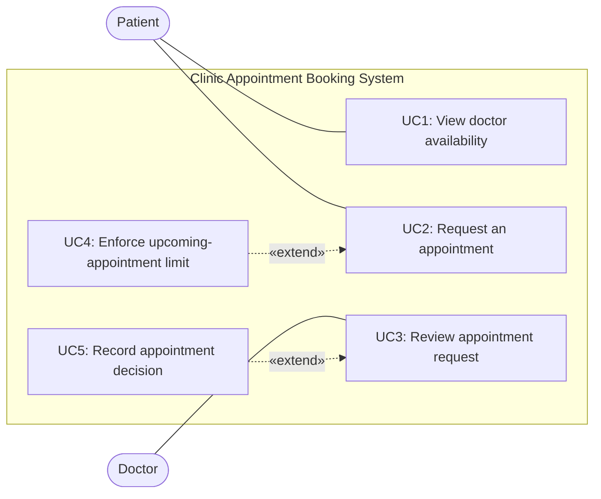

# 2. Use Cases (P2)

Actors required by the task: **Patient** and **Doctor**. Non-functional requirements R5–R7 constrain the design and are not drawn as standalone user goals.

## Use-case list

| UC | Name | Actor | Requirement | Use-case statement |
|---|---|---|---|---|
| UC1 | View doctor availability | Patient | R1 | As a Patient, I view the days and times when a selected Doctor is available. |
| UC2 | Request an appointment | Patient | R2, R4 | As a Patient, I request an appointment in an available time slot, provided I have fewer than N upcoming appointments. |
| UC3 | Review appointment request | Doctor | R3 | As a Doctor, I accept or decline a pending appointment request assigned to me. |
| UC4 | Enforce upcoming-appointment limit | System behavior | R4 | The system counts the Patient's upcoming requests/appointments and refuses a new request when the limit has already been reached. This behavior supports UC2. |
| UC5 | Record appointment decision | System behavior | R3 | The system records the Doctor's decision as Accepted or Declined and makes the resulting status available to the Patient. This is the system response to UC3, not a separate external actor. |

## UC2 — Request an appointment

**Preconditions**
1. The Patient and Doctor exist in the in-memory system.
2. The selected time slot belongs to the Doctor's availability and is in the future.

**Main flow**
1. The Patient views the Doctor's available slots for a date (UC1).
2. The Patient selects a slot and submits a booking request.
3. The system checks that the slot is still available.
4. The system counts the Patient's upcoming Pending and Accepted appointments.
5. If the count is less than N, the system creates an appointment with status `Pending`.
6. The system returns the request status to the Patient.
7. The Doctor reviews the pending request using UC3.
8. The Doctor accepts or declines; the system records the decision (UC5).

**Alternative flow — slot is no longer available or the Patient has reached N**
1. At step 3, the system finds that the slot is already reserved, is not in the Doctor's availability, or is in the past; **or** at step 4, the count is already N.
2. The system rejects the booking request and explains the reason.
3. No appointment request is created and the Patient's appointment count is unchanged.

**Postconditions**
- On a valid request, a `Pending` appointment exists and reserves the slot while awaiting the Doctor's decision.
- If the Doctor declines, the appointment becomes `Declined`; it no longer reserves the slot and does not count toward N.
- If accepted, its status becomes `Accepted` and it counts toward N while it is in the future.

## UC3 — Review appointment request

**Preconditions:** The appointment exists, is `Pending`, and is assigned to the Doctor performing the review.

**Main flow**
1. The Doctor chooses to accept or decline the request.
2. The system verifies that the appointment is pending and belongs to this Doctor.
3. The system updates the status to `Accepted` or `Declined`.
4. The status is returned to the Patient-facing caller.
5. A declined slot becomes available again; an accepted slot remains reserved.

**Alternative flow:** If the appointment is not pending or belongs to a different Doctor, the system refuses the decision update and leaves the status unchanged.

## Assumptions made explicit

- `N = 3` is a team-selected value because the supplied task asks the team to choose N.
- A future `Pending` request counts toward N, preventing a Patient from making several simultaneous pending requests that exceed the limit.
- `Pending` and `Accepted` appointments reserve their slots. `Declined` appointments do not.
- The demo uses the statuses `Pending`, `Accepted`, and `Declined` so the request/decision lifecycle is visible.

# Use Case Diagram (P3)

**Review checks:** Patient and Doctor are outside the system boundary; the five use cases are inside it. UC4 is system behavior supporting a booking request, and UC5 records the result of a Doctor's decision. R5–R7 are quality constraints rather than standalone use cases.
