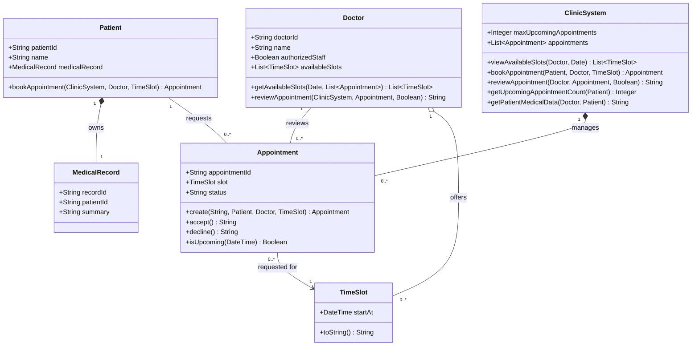

# 4. Class Diagram (P5)

## Consistency checklist

- Every relationship includes multiplicity.
- One appointment belongs to exactly one Patient, one Doctor, and one TimeSlot.
- One Patient and one Doctor can each be related to many appointments.
- A pending or accepted appointment reserves its TimeSlot; a declined appointment releases it.
- `ClinicSystem` owns the booking rules, including the configured N and medical-data access check.
- Methods used in the sequence diagram have matching names and responsibilities here.
