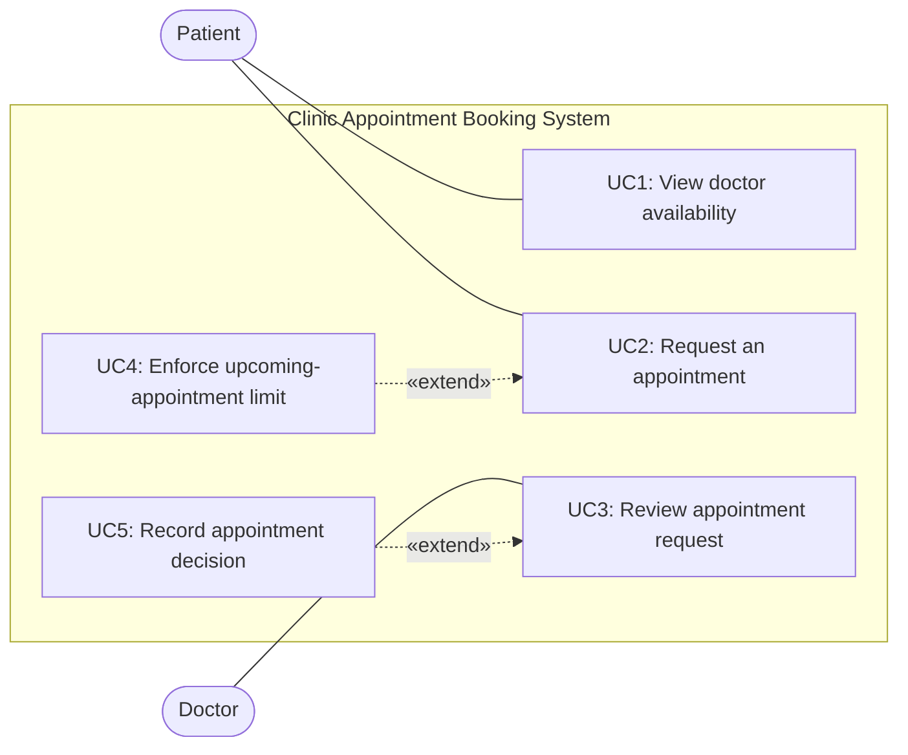

# Use Case Diagram (P3)

**Review checks:** Patient and Doctor are outside the system boundary; the five use cases are inside it. UC4 is system behavior supporting a booking request, and UC5 records the result of a Doctor's decision. R5–R7 are quality constraints rather than standalone use cases.
